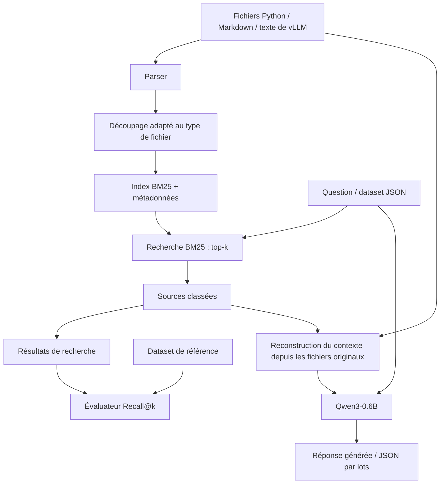

*This project has been created as part of the 42 curriculum by cpietrza.*

# RAG against the machine

**Retrieval-Augmented Generation — Will you answer my questions?**

[English](README.md) | **Français**

## Description

Ce projet implémente un système local de génération augmentée par la recherche (RAG, Retrieval-Augmented Generation) destiné à répondre à des questions sur le code source et la documentation de **vLLM 0.10.1**. Au lieu de s'appuyer uniquement sur les connaissances acquises par un modèle pendant son entraînement, le système recherche des extraits pertinents dans une base de code précise et les fournit au modèle au moment de l'inférence.

Le pipeline indexe les fichiers Python et Markdown/texte, classe leurs fragments avec BM25, reconstruit le contexte à partir des fichiers originaux et génère une réponse avec **Qwen/Qwen3-0.6B**. La recherche et la génération peuvent être exécutées indépendamment, pour une question unique ou un dataset JSON complet. Un évaluateur interne mesure la qualité de la recherche avec Recall@k.

Ce projet pédagogique de l'école 42 repose sur la version 2.0 du sujet. Son objectif principal est la pertinence des sources retrouvées et la génération de réponses fondées sur celles-ci, et non l'entraînement ou le fine-tuning d'un LLM.

## Sommaire

- [Instructions](#instructions)
- [Exemples d'utilisation](#exemples-dutilisation)
- [Architecture du système](#architecture-du-système)
- [Stratégie de chunking](#stratégie-de-chunking)
- [Méthode de recherche](#méthode-de-recherche)
- [Génération des réponses](#génération-des-réponses)
- [Modèles de données et sorties](#modèles-de-données-et-sorties)
- [Analyse des performances](#analyse-des-performances)
- [Choix de conception](#choix-de-conception)
- [Difficultés rencontrées](#difficultés-rencontrées)
- [Ressources](#ressources)

## Instructions

### Prérequis

- Python **3.12 ou supérieur** (selon `pyproject.toml` ; le sujet impose Python 3.10 au minimum).
- [uv](https://docs.astral.sh/uv/), Git et Make pour les raccourcis fournis.
- Le corpus vLLM 0.10.1 et les datasets de questions fournis avec le sujet.
- Suffisamment de mémoire et d'espace disque pour PyTorch, Transformers et les poids du modèle. Une connexion Internet est nécessaire pour le téléchargement initial des dépendances et du modèle, sauf s'ils sont déjà en cache. Le placement du modèle sur les périphériques est automatique ; le code n'impose pas explicitement de GPU dédié.

### Installation

```bash
git clone https://github.com/Chrisnox-209/RAG_Retrieval-Augmented-Generation.git
cd RAG_Retrieval-Augmented-Generation
uv sync
```

Il est également possible d'utiliser `make install`. Les dépendances sont gérées par `pyproject.toml` et `uv.lock`. Aucune compilation séparée n'est nécessaire.

Le modèle Hugging Face par défaut est public. Si une authentification est nécessaire, copier `.env.example` vers `.env` et renseigner `HF_TOKEN` avec un jeton personnel en lecture seule. Ne jamais versionner ce jeton.

### Structure du projet

Placer le corpus et les datasets fournis aux emplacements ci-dessous avant d'exécuter le pipeline. Les répertoires de l'index et des résultats sont générés à l'exécution.

```text
.
├── README.md
├── README.fr.md
├── Makefile
├── pyproject.toml
├── uv.lock
├── .env.example
├── src/
│   ├── __main__.py     # Point d'entrée Python Fire
│   ├── cli.py          # Orchestration du pipeline
│   ├── parse.py        # Lecture des sources et datasets
│   ├── chunker.py      # Découpage Python et texte
│   ├── indexer.py      # Création et sauvegarde de l'index BM25
│   ├── retriever.py    # Chargement et recherche classée
│   ├── generator.py    # Reconstruction du contexte et inférence
│   ├── evaluator.py    # Évaluation locale Recall@k
│   ├── models.py       # Modèles Pydantic
│   ├── tests.py        # Vérification des positions des sources
│   └── utils.py        # Conversion des sources et couleurs terminal
└── data/
    ├── raw/vllm-0.10.1/
    ├── datasets/
    │   ├── AnsweredQuestions/
    │   │   ├── dataset_docs_public.json
    │   │   └── dataset_code_public.json
    │   └── UnansweredQuestions/
    │       ├── dataset_docs_public.json
    │       └── dataset_code_public.json
    ├── processed/
    │   ├── bm25/
    │   └── info/chunk_info.json
    └── output/
        ├── search_results/<DatasetScope>/
        └── search_results_and_answer/<DatasetScope>/
```

Exécuter les commandes depuis la racine du dépôt. Les chemins relatifs, par exemple `data/raw/vllm-0.10.1/...`, doivent correspondre exactement à ceux du dataset de référence. Ne pas modifier le corpus après indexation : les positions des caractères se réfèrent à son contenu. Les fichiers de données volumineux, les poids du modèle et les résultats générés ne doivent pas être soumis dans le dépôt d'évaluation de 42.

### Makefile

| Commande | Fonction |
| --- | --- |
| `make install` | Installer les dépendances avec uv. |
| `make run` | Démarrer la CLI sans sous-commande. |
| `make debug` | Lancer le module avec le débogueur pdb. |
| `make lint` | Exécuter mypy avec les options requises et flake8 sur `src/`. |
| `make lint-strict` | Exécuter les vérifications statiques renforcées sur `src/`. |
| `make clean` | Suppression caches, l'index et les résultats ; conserver `data/raw/` et `data/datasets/`. |
| `make index` | Construire l'index (2 000 caractères et 33 % de recouvrement par défaut dans le Makefile). |
| `make search` | Rechercher sur les deux datasets publics sans réponses (`K=5` par défaut). |
| `make evaluate` | Lancer l'évaluateur interne sur les deux datasets publics. |
| `make moulinette` | Lancer la moulinette Ubuntu fournie sur les deux datasets publics. |
| `make answer` | Générer les réponses pour les deux fichiers de résultats publics. |
| `make full` | Enchaîner indexation, recherche par lots et l'évaluation et générer les réponses. |

Pour la cible correspondante, placer l'exécutable `moulinette-ubuntu`, fourni séparément, à la racine du projet. L'évaluateur externe n'est ni importé ni invoqué par l'implémentation Python.

## Exemples d'utilisation

### 1. Construire l'index

```bash
uv run python -m src index --max_chunk_size 2000 --chunk_overlap_percent 15
```

La CLI utilise par défaut 2 000 caractères et 15 % de recouvrement ; `make index` utilise 33 %. Les chemins des sources et de l'index sont configurables pour l'indexation. Les exemples suivants utilisent le répertoire `data/processed/`, actuellement attendu par la recherche par lots.

### 2. Rechercher une question unique

```bash
uv run python -m src search --query "What is the KV cache?" --k 5
```

L'option `--test=True` vérifie que les chemins et positions retournés permettent de reconstruire le texte indexé.

### 3. Rechercher sur un dataset

```bash
uv run python -m src search_dataset \
  --dataset_path data/datasets/UnansweredQuestions/dataset_docs_public.json \
  --k 5 \
  --save_directory data/output/search_results/UnansweredQuestions
```

Le fichier produit est `data/output/search_results/UnansweredQuestions/dataset_docs_public.json`. Utiliser `dataset_code_public.json` pour les questions sur le code. Séparer les résultats selon le type de dataset pour éviter d'écraser les fichiers portant le même nom.

### 4. Évaluer la recherche

Évaluation interne :

```bash
uv run python -m src evaluate \
  --student_search_results_path data/output/search_results/UnansweredQuestions/dataset_docs_public.json \
  --dataset_path data/datasets/AnsweredQuestions/dataset_docs_public.json
```

Évaluation officielle (avec l'exécutable Ubuntu fourni) :

```bash
./moulinette-ubuntu evaluate_student_search_results \
  data/output/search_results/UnansweredQuestions/dataset_docs_public.json \
  data/datasets/AnsweredQuestions/dataset_docs_public.json \
  --k 5 --max_context_length 2000
```

Pour mesurer Recall@10, lancer la recherche avec `--k 10` avant l'évaluation avec `--k 10`. L'évaluateur interne affiche le k enregistré dans le fichier de résultats. La moulinette externe fait foi lors de la soutenance.

### 5. Répondre à une question unique

```bash
uv run python -m src answer --query "What is the KV cache?" --k 5
```

Le modèle par défaut peut être indiqué explicitement avec `--llm Qwen/Qwen3-0.6B`.

### 6. Générer les réponses d'un dataset

```bash
uv run python -m src answer_dataset \
  --student_search_results_path data/output/search_results/UnansweredQuestions/dataset_docs_public.json \
  --save_directory data/output/search_results_and_answer/UnansweredQuestions
```

Le fichier produit conserve les identifiants, les questions et les sources retrouvées et ajoute les réponses générées. Le modèle est chargé une seule fois pour le lot.

### Aide de la CLI

```bash
uv run python -m src --help
uv run python -m src index --help
```

## Architecture du système



1. **Parsing :** `parse.py` charge récursivement les fichiers UTF-8 `.py`, `.md` et `.txt` dans des modèles `SourceFile`. Les fichiers incompatibles ou illisibles sont ignorés ; les datasets sont validés avec Pydantic.
2. **Chunking :** `chunker.py` découpe les fichiers selon leur type et conserve les positions originales des caractères.
3. **Indexation :** `indexer.py` tokenize les fragments avec BM25S et sauvegarde l'index, le corpus et les métadonnées associées dans `data/processed/`.
4. **Recherche :** `retriever.py` charge l'index persistant, classe les fragments pour la requête tokenisée et associe les identifiants BM25 aux chemins et positions d'origine.
5. **Augmentation et génération :** `generator.py` lit les plages de caractères originales, construit un contexte numéroté et demande à Qwen de produire une réponse fondée sur ces sources.
6. **Évaluation :** `evaluator.py` compare les sources retrouvées au dataset de référence, indépendamment de la génération des réponses.

`cli.py` orchestre ces étapes. Python Fire expose les six commandes et tqdm affiche la progression du découpage, de la recherche par lots et de la génération par lots.

## Stratégie de chunking

Le projet utilise deux découpeurs distincts de `langchain-text-splitters`, plutôt qu'une fenêtre fixe identique pour tous les fichiers.

| Type de source | Découpeur | Approche |
| --- | --- | --- |
| Python (`.py`) | `PythonCodeTextSplitter` | Favorise la structure du code, notamment les limites de classes et de fonctions lorsque possible. |
| Markdown / texte (`.md`, `.txt`) | `MarkdownTextSplitter` | Favorise les titres, paragraphes et autres séparations textuelles lorsque possible. |

Il s'agit de découpeurs textuels récursifs et non d'un parseur AST. Une fonction ou une section volumineuse peut être divisée en plusieurs fragments.

- Taille configurable de 1 à 2 000 **caractères**, avec 2 000 par défaut.
- Recouvrement configurable de 0 % à 99 %, converti en caractères par `int(chunk_size * overlap_percent / 100)`.
- Pour 2 000 caractères, 15 % correspondent à un recouvrement configuré de 300 caractères et 33 % à 660 caractères. Le recouvrement réel dépend des séparations.
- `add_start_index=True`, `strip_whitespace=False` et `keep_separator=True` préservent le lien avec le texte original.
- Chaque fragment est comparé à `original_text[start:end]`. La borne de début est incluse et celle de fin est exclue. Un fichier vide ne produit aucun fragment.

Le recouvrement limite le risque de perdre du contexte aux frontières, mais augmente la taille de l'index et peut entraîner des résultats redondants. Les expériences présentées plus bas montrent l'effet du recouvrement à taille de fragment constante.

## Méthode de recherche

L'algorithme de recherche lexicale est **BM25 (Best Matching 25)**, utilisé via [BM25S](https://bm25s.github.io/). BM25 favorise les fragments contenant des termes informatifs de la requête, tout en prenant en compte la saturation de leur fréquence et la longueur des documents. Dans l'index, un document représente un fragment, et non un fichier entier.

Une formulation classique du score BM25 est :

```text
score(D, Q) = somme pour chaque terme t de la requête :
    IDF(t) * f(t,D) * (k1 + 1)
    / (f(t,D) + k1 * (1 - b + b * |D| / avgdl))
```

`f(t,D)` représente la fréquence du terme, `|D|` la longueur du fragment en termes, `avgdl` la longueur moyenne des documents, et `k1` et `b` contrôlent la saturation et la normalisation par la longueur. Cette formule illustre le principe : le code délègue le calcul et la tokenisation à BM25S sans modifier ses paramètres de classement par défaut.

Le corpus et les requêtes sont tokenisés avec `bm25s.tokenize`. Les résultats classés sont associés aux métadonnées de `chunk_info.json` grâce à leurs identifiants. Le nombre d'éléments du corpus et des métadonnées est vérifié au chargement, et les identifiants doivent appartenir à l'intervalle valide. Les scores et textes des fragments sont utilisés en interne ; les résultats publics contiennent les emplacements minimaux des sources.

La recherche par lots charge l'index une seule fois et le réutilise pour chaque question. Aucun embedding, reclassement sémantique ni recherche hybride n'est utilisé dans le pipeline inspecté. BM25 est particulièrement adapté aux termes techniques et identifiants, mais une recherche purement lexicale peut manquer des synonymes et reformulations.

## Génération des réponses

Le modèle par défaut est `Qwen/Qwen3-0.6B`, chargé localement avec Hugging Face Transformers et PyTorch via `device_map="auto"`.

Pour chaque question, le système lit les plages de caractères sélectionnées dans les fichiers d'origine et les concatène sous la forme `Source 1:`, `Source 2:`, etc. Le prompt système demande au modèle de répondre à partir du contexte et de signaler les informations insuffisantes. La question et le contexte sont placés dans le message utilisateur puis formatés avec le chat template du modèle.

Le mode de réflexion et l'échantillonnage sont désactivés (`enable_thinking=False`, `do_sample=False`). La réponse est limitée à 256 nouveaux tokens. Les tokens générés sont séparés des tokens d'entrée avant décodage. Cette stratégie favorise des réponses concises et reproductibles, sans garantir leur exactitude.

Le constructeur de contexte concatène actuellement toutes les sources retrouvées : il ne compte pas explicitement les tokens d'entrée et n'ajuste pas le contexte au budget disponible du modèle. Il s'agit d'une amélioration restante, notamment lorsque k est élevé. La limite de 2 000 caractères par source ne garantit pas le respect du budget de tokens.

## Modèles de données et sorties

Les modèles Pydantic de `src/models.py` valident les structures échangées entre les étapes du pipeline.

| Modèle | Rôle |
| --- | --- |
| `SourceFile`, `ChunkModel` | Fichiers chargés et fragments avec positions. |
| `MinimalSource` | Chemin du fichier et positions de début et de fin. |
| `UnansweredQuestion`, `AnsweredQuestion`, `RagDataset` | Questions d'entrée et réponses/sources de référence. |
| `MinimalSearchResults`, `StudentSearchResults` | Emplacements des sources et valeur de k pour un lot. |
| `MinimalAnswer`, `StudentSearchResultsAndAnswer` | Résultats de recherche enrichis des réponses générées. |

La recherche par lots écrit un JSON conforme à `StudentSearchResults` et la génération par lots un JSON conforme à `StudentSearchResultsAndAnswer`. Dans l'implémentation actuelle, la recherche unitaire retourne des modèles de sources dans la CLI et la réponse unitaire retourne du texte.

Exemple illustratif de résultat par lots (positions fictives) :

```json
{
  "search_results": [
    {
      "question_id": "q1",
      "question": "How does vLLM support LoRA?",
      "retrieved_sources": [
        {
          "file_path": "data/raw/vllm-0.10.1/docs/features/lora.md",
          "first_character_index": 0,
          "last_character_index": 1500
        }
      ]
    }
  ],
  "k": 1
}
```

Un résultat de génération ajoute une chaîne `answer` à chaque élément de `search_results`. Les identifiants et chemins doivent rester inchangés entre les étapes. L'exemple illustre uniquement la structure, pas une preuve pertinente pour la question indiquée.

## Analyse des performances

### Métrique d'évaluation

Recall@k mesure la proportion des sources de référence retrouvées parmi les k premiers fragments. Une source est considérée comme retrouvée si le chemin du fichier correspond exactement et si l'intersection sur l'union (IoU, Intersection over Union) des plages de caractères est supérieure ou égale à 0,05.

```text
IoU = longueur(intersection des plages) / longueur(union des plages)
Recall@k(question) = sources de référence retrouvées / total des sources de référence
```

L'évaluateur interne associe les questions par identifiant, compare chaque source de référence aux emplacements retrouvés et calcule la moyenne des recalls par question pour les questions associées disposant de sources de référence. Il indique le nombre de questions ignorées et le k enregistré. Il vérifie actuellement toutes les sources retournées sans appliquer une nouvelle découpe à k ; la moulinette externe reste la référence officielle.

### Résultats des datasets publics

Mesures historiques de la moulinette enregistrées le 13 novembre 2026 (100 questions sur la documentation et 99 sur le code) :

| Dataset | Recall@1 | Recall@3 | Recall@5 | Recall@10 |
| --- | ---: | ---: | ---: | ---: |
| Documentation | 59,0 % | 79,0 % | **84,0 %** | 91,0 % |
| Code | 33,3 % | 48,5 % | **56,6 %** | 60,6 % |

Ces deux valeurs historiques de Recall@5 dépassent les seuils du sujet. Elles ne constituent pas une nouvelle mesure du dernier commit ni de la configuration à 33 % du Makefile.

### Expérimentation sur le recouvrement

Expérience historique enregistrée le 14 novembre 2026 avec des fragments de 2 000 caractères et 1 965 fichiers récupérés :

| Recouvrement configuré | Fragments | Recall@5 docs | Recall@5 code |
| ---: | ---: | ---: | ---: |
| 15 % | 14 810 | 84 % | 56,6 % |
| 20 % | 15 043 | 85 % | 57,6 % |
| 25 % | 15 317 | 85 % | 57,6 % |
| 30 % | 15 631 | 86 % | 57,6 % |
| 35 % | 15 988 | 85 % | 58,6 % |
| 40 % | 16 397 | 85 % | 58,6 % |

Dans cette expérience, 30 % donne le meilleur recall sur la documentation et 35–40 % le meilleur recall sur le code. L'augmentation du recouvrement augmente le nombre de fragments sans amélioration systématique du recall documentaire. Le Makefile actuel fixe 33 % ; ce tableau ne permet pas d'établir son recall exact. Aucun résultat pour des tailles maximales inférieures n'est consigné ici.

### Exigences du sujet et temps d'exécution

| Indicateur | Exigence | Mesure / état |
| --- | --- | --- |
| Recall@5 documentation | ≥ 80 % | 84,0 % lors du benchmark historique |
| Recall@5 code | ≥ 50 % | 56,6 % lors du benchmark historique |
| Indexation du corpus complet | ≤ 5 minutes | Temps non consigné ici |
| Recherche sur 200 questions | ≤ 90 secondes | Temps non consigné ici |
| Longueur des sources retrouvées | ≤ 2 000 caractères | Taille configurée contrôlée au découpage ; valider les sorties avec la moulinette |

Pour mesurer la configuration actuelle sur la machine utilisée (après installation des dépendances) :

```bash
time make index
time make search
make moulinette
```

Les datasets publics ci-dessus totalisent 199 questions ; un test sur 200 questions reste nécessaire pour vérifier précisément l'exigence de débit. `time make search` inclut les deux démarrages de processus et chargements de l'index. Consigner le matériel, la taille des fragments, le recouvrement, k et le temps réel écoulé. La latence de génération est distincte du débit de recherche.

## Choix de conception

| Choix | Justification |
| --- | --- |
| Recherche lexicale BM25S | Recherche creuse efficace, sans modèle d'embeddings. |
| Découpeurs distincts selon le type | Le code et la documentation ont des frontières utiles différentes. |
| Taille et recouvrement configurables | Permet d'expérimenter sur le recall tout en respectant la limite de longueur des sources. |
| Index et métadonnées persistants | Évite de reconstruire l'index à chaque requête et préserve la traçabilité. |
| Séparation recherche/génération | Permet de mesurer le recall sans charger le LLM. |
| Pydantic et JSON | Assure des interfaces typées entre étapes et le format par lots attendu. |
| Qwen3-0.6B et décodage déterministe | Respecte le modèle par défaut et évite les variations dues à l'échantillonnage. |
| Python Fire, tqdm et uv | Fournit la CLI, les barres de progression et la gestion des dépendances exigées. |

## Difficultés rencontrées

- **Conservation des positions des sources :** le découpage ou la suppression d'espaces peut modifier les positions. Le découpeur conserve séparateurs et espaces et compare les fragments aux plages originales ; `--test=True` apporte une vérification supplémentaire à la recherche.
- **Association entre BM25 et métadonnées :** des identifiants invalides ou des longueurs incohérentes entre corpus et métadonnées peuvent produire de mauvaises sources. Des contrôles de bornes et de cohérence ont été ajoutés.
- **Compromis entre contexte et recall :** les expérimentations sur le recouvrement montrent le compromis entre couverture des sources et croissance de l'index. Les deux paramètres de découpage sont exposés dans la CLI pour permettre des essais reproductibles.
- **Génération fondée sur les sources :** le petit modèle peut halluciner ou omettre des informations. Le prompt lui demande de s'appuyer sur le contexte et d'admettre l'absence d'éléments suffisants.
- **Entrées invalides :** les fichiers absents, JSON mal formés, requêtes vides et valeurs de k hors limites font l'objet de contrôles et de messages d'erreur. La couverture exhaustive des cas limites reste à tester.

### Limites actuelles et points de validation

Les points suivants restent à vérifier ou améliorer avant la soumission finale :

- Gestion explicite du budget de tokens d'entrée lors de la génération, notamment si k est élevé.
- Écriture JSON pour les commandes unitaires si exigée par la section Output du sujet ; les commandes par lots produisent déjà les formats JSON demandés.
- Gestion d'un lot vide dans `answer_dataset` (la fonction accède actuellement à la première question) et validation exhaustive des requêtes dégénérées.
- Vérification des docstrings et du lint sur tout le dépôt : le Makefile actuel limite le lint à `src/`, alors que le sujet prescrit des vérifications sur `.` ; plusieurs fonctions ne disposent pas encore de docstring.
- Confirmation des conventions de chemins, nouvelles mesures de temps et de Recall@5 sur la configuration finale, et exclusion des fichiers volumineux et résultats générés de la soumission.

Aucun bonus facultatif n'est présenté comme validé dans ce README.

## Ressources

### Références originales du projet

- [LangChain : introduction et exemples d'utilisation](https://agence-scroll.com/blog/langchain-quest-ce-que-cest-7-exemples-dutilisation)
- [LangChain — Découpage du code](https://docs.langchain.com/oss/python/integrations/splitters/code_splitter)
- [LangChain — Découpage Markdown par métadonnées de titres](https://docs.langchain.com/oss/python/integrations/splitters/markdown_header_metadata_splitter) (documentation connexe ; l'implémentation utilise `MarkdownTextSplitter`).
- [BM25S](https://bm25s.github.io/)
- [tqdm](https://tqdm.github.io/)

### Références complémentaires

- [Retrieval-Augmented Generation for Knowledge-Intensive NLP Tasks — Lewis et al.](https://arxiv.org/abs/2005.11401)
- [BM25 et BM25F — Robertson et Zaragoza](https://doi.org/10.1561/1500000019)
- [Code source de vLLM 0.10.1](https://github.com/vllm-project/vllm/tree/v0.10.1)
- [Fiche du modèle Qwen3-0.6B](https://huggingface.co/Qwen/Qwen3-0.6B)
- [Hugging Face Transformers](https://huggingface.co/docs/transformers/)
- [PyTorch](https://pytorch.org/docs/)
- [Pydantic](https://docs.pydantic.dev/)
- [Python Fire](https://github.com/google/python-fire)
- 42 — *RAG against the machine*, sujet version 2.0 (fourni par l'école).

### Utilisation de l'intelligence artificielle

ChatGPT a été utilisé comme assistant d'apprentissage et de développement pour expliquer les concepts du RAG, examiner la logique du parsing, du chunking, de l'indexation et de la recherche, étudier les erreurs de typage Python et de métadonnées BM25, discuter de la conception du prompt et du budget de contexte, interpréter les résultats des benchmarks et aider à rédiger puis traduire ce README. Ces usages concernent `parse.py`, `chunker.py`, `indexer.py`, `retriever.py`, `generator.py`, l'intégration CLI et la documentation du projet.

Le README décrit l'implémentation et les expérimentations historiques, sans prétendre qu'une nouvelle validation complète a été réalisée par l'IA. Les suggestions et la documentation produites avec l'IA doivent être relues et comprises par l'auteur du projet avant la soumission. Indépendamment de cette assistance au développement, Qwen3-0.6B est le modèle de langage utilisé à l'exécution par l'application RAG.
