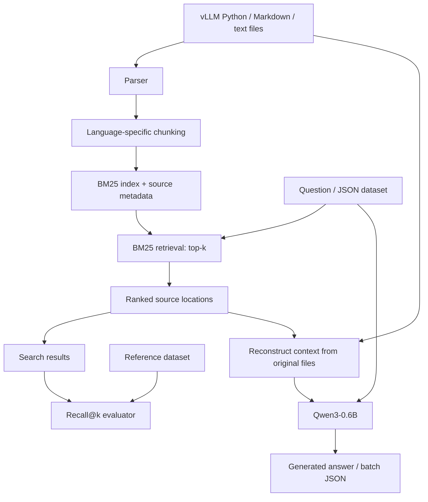

*This project has been created as part of the 42 curriculum by cpietrza.*

# RAG against the machine

**Retrieval-Augmented Generation — Will you answer my questions?**

**English** | [Français](README.fr.md)

## Description

This project implements a local Retrieval-Augmented Generation (RAG) system designed to answer questions about the source code and documentation of **vLLM 0.10.1**. Instead of relying solely on a language model's training data, it searches a specific codebase and supplies relevant source excerpts to the model at inference time.

The pipeline indexes Python and Markdown/text files, ranks their chunks with BM25, reconstructs the retrieved context from the original files and generates an answer using **Qwen/Qwen3-0.6B**. Retrieval and generation can be performed independently, for a single question or an entire JSON dataset. An internal evaluator measures retrieval quality using Recall@k.

This is a 42 educational project based on subject version 2.0. Its main objective is accurate source retrieval and grounded answer generation, not training or fine-tuning an LLM.

## Table of contents

- [Instructions](#instructions)
- [Example usage](#example-usage)
- [System architecture](#system-architecture)
- [Chunking strategy](#chunking-strategy)
- [Retrieval method](#retrieval-method)
- [Answer generation](#answer-generation)
- [Data models and output](#data-models-and-output)
- [Performance analysis](#performance-analysis)
- [Design decisions](#design-decisions)
- [Challenges faced](#challenges-faced)
- [Resources](#resources)

## Instructions

### Requirements

- Python **3.12 or later** (as declared in `pyproject.toml`; the subject requires at least Python 3.10).
- [uv](https://docs.astral.sh/uv/) and Git; Make for the provided shortcuts.
- The vLLM 0.10.1 corpus and question datasets supplied with the subject.
- Sufficient disk space and memory for PyTorch, Transformers and the model weights. Internet access is needed for the initial dependency and model downloads unless they are already cached. Generation uses automatic device placement; a dedicated GPU is not explicitly required by the code.

### Installation

```bash
git clone https://github.com/Chrisnox-209/RAG_Retrieval-Augmented-Generation.git
cd RAG_Retrieval-Augmented-Generation
uv sync
```

Alternatively, run `make install` instead of `uv sync`. The project uses `pyproject.toml` and `uv.lock` for dependency management. No separate compilation step is required.

The default Hugging Face model is public. If authentication is needed, copy `.env.example` to `.env` and set `HF_TOKEN` to your own read-only token. Never commit the token.

### Project layout

Place the supplied corpus and datasets in the locations shown below before running the pipeline. The index and output directories are generated at runtime.

```text
.
├── README.md
├── README.fr.md
├── Makefile
├── pyproject.toml
├── uv.lock
├── .env.example
├── src/
│   ├── __main__.py     # Python Fire entry point
│   ├── cli.py          # Pipeline orchestration
│   ├── parse.py        # Source and dataset loading
│   ├── chunker.py      # Python and text splitting
│   ├── indexer.py      # BM25 index creation and persistence
│   ├── retriever.py    # Index loading and ranked retrieval
│   ├── generator.py    # Context reconstruction and LLM inference
│   ├── evaluator.py    # Local Recall@k evaluation
│   ├── models.py       # Pydantic schemas
│   ├── tests.py        # Source-position verification
│   └── utils.py        # Source conversion and terminal colors
└── data/
    ├── raw/vllm-0.10.1/
    ├── datasets/
    │   ├── AnsweredQuestions/
    │   │   ├── dataset_docs_public.json
    │   │   └── dataset_code_public.json
    │   └── UnansweredQuestions/
    │       ├── dataset_docs_public.json
    │       └── dataset_code_public.json
    ├── processed/
    │   ├── bm25/
    │   └── info/chunk_info.json
    └── output/
        ├── search_results/<DatasetScope>/
        └── search_results_and_answer/<DatasetScope>/
```

Run commands from the repository root. Relative paths such as `data/raw/vllm-0.10.1/...` must match the reference dataset exactly. Keep the original corpus unchanged after indexing; character offsets refer to its contents. Large datasets, weights and generated outputs should not be submitted to the 42 evaluation repository.

### Makefile

| Command | Purpose |
| --- | --- |
| `make install` | Install dependencies with uv. |
| `make run` | Start the CLI without a subcommand. |
| `make debug` | Start the module with Python's pdb debugger. |
| `make lint` | Run mypy with the required flags and flake8 on `src/`. |
| `make lint-strict` | Run stricter static checks on `src/`. |
| `make clean` | Remove the virtual environment, selected caches, processed data and outputs; preserve `data/raw/` and `data/datasets/`. |
| `make index` | Build the index (2,000 characters and 33% overlap by default in the Makefile). |
| `make search` | Search both public unanswered datasets (default `K=5`). |
| `make evaluate` | Run the internal evaluator on both public datasets. |
| `make moulinette` | Run the supplied Ubuntu evaluator on both public datasets. |
| `make answer` | Generate answers for both public search-result files. |
| `make full` | Run indexing, batch retrieval and external evaluation; does not generate answers. |

The `moulinette-ubuntu` executable must be supplied separately at the repository root for the corresponding Makefile target. The external evaluator is not imported or invoked by the Python implementation.

## Example usage

### 1. Build the index

```bash
uv run python -m src index --max_chunk_size 2000 --chunk_overlap_percent 15
```

The CLI defaults to 2,000 characters and 15% overlap; `make index` uses 33%. Both source and processed paths can be configured for indexing. The examples below use the default `data/processed/` location, which batch search currently expects.

### 2. Search a single question

```bash
uv run python -m src search --query "What is the KV cache?" --k 5
```

The optional `--test=True` verifies that the returned paths and character offsets reconstruct the indexed text.

### 3. Search a dataset

```bash
uv run python -m src search_dataset \
  --dataset_path data/datasets/UnansweredQuestions/dataset_docs_public.json \
  --k 5 \
  --save_directory data/output/search_results/UnansweredQuestions
```

The output is `data/output/search_results/UnansweredQuestions/dataset_docs_public.json`. Use `dataset_code_public.json` for code questions. Separate output folders by dataset scope to prevent files with identical names from overwriting each other.

### 4. Evaluate retrieval

Internal evaluation:

```bash
uv run python -m src evaluate \
  --student_search_results_path data/output/search_results/UnansweredQuestions/dataset_docs_public.json \
  --dataset_path data/datasets/AnsweredQuestions/dataset_docs_public.json
```

Official evaluation (with the supplied Ubuntu executable):

```bash
./moulinette-ubuntu evaluate_student_search_results \
  data/output/search_results/UnansweredQuestions/dataset_docs_public.json \
  data/datasets/AnsweredQuestions/dataset_docs_public.json \
  --k 5 --max_context_length 2000
```

For Recall@10, run batch retrieval with `--k 10` before evaluating with `--k 10`. The internal evaluator reports the k recorded in the result file. The external moulinette is authoritative for the defense.

### 5. Answer a single question

```bash
uv run python -m src answer --query "What is the KV cache?" --k 5
```

The default model can be selected explicitly with `--llm Qwen/Qwen3-0.6B`.

### 6. Generate answers for a dataset

```bash
uv run python -m src answer_dataset \
  --student_search_results_path data/output/search_results/UnansweredQuestions/dataset_docs_public.json \
  --save_directory data/output/search_results_and_answer/UnansweredQuestions
```

The result file retains the question IDs, questions and retrieved sources and adds the generated answers. The model is loaded once for the batch.

### CLI help

```bash
uv run python -m src --help
uv run python -m src index --help
```

## System architecture



1. **Parsing:** `parse.py` recursively loads UTF-8 `.py`, `.md` and `.txt` files into `SourceFile` models. Unsupported or unreadable files are skipped; datasets are validated using Pydantic.
2. **Chunking:** `chunker.py` splits files according to their type and records the original character offsets.
3. **Indexing:** `indexer.py` tokenizes chunk texts with BM25S and saves the searchable index, corpus and parallel metadata under `data/processed/`.
4. **Retrieval:** `retriever.py` loads the persisted index, ranks chunks for a tokenized query and maps the returned document IDs to their original file paths and offsets.
5. **Augmentation and generation:** `generator.py` reads the original source ranges, assembles a numbered context and prompts Qwen to produce a grounded answer.
6. **Evaluation:** `evaluator.py` compares retrieved source locations with the reference dataset independently of answer generation.

`cli.py` coordinates these stages. Python Fire exposes the six commands; tqdm provides progress indicators for chunking, batch retrieval and batch generation.

## Chunking strategy

The project uses two distinct splitters from `langchain-text-splitters` rather than applying an identical fixed-window strategy to every file.

| Source type | Splitter | Approach |
| --- | --- | --- |
| Python (`.py`) | `PythonCodeTextSplitter` | Uses Python-oriented separators to favor code structure, including class and function boundaries where possible. |
| Markdown / text (`.md`, `.txt`) | `MarkdownTextSplitter` | Uses Markdown-oriented separators to favor headings, paragraphs and other textual boundaries where possible. |

These are recursive text splitters, not an AST parser. A large function or section can still be divided into multiple chunks.

- Chunk size: configurable from 1 to 2,000 **characters**, default 2,000.
- Overlap: configurable from 0% to 99%, converted to characters with `int(chunk_size * overlap_percent / 100)`.
- At 2,000 characters, 15% corresponds to a configured overlap of 300 characters and 33% to 660 characters. Actual overlap depends on separator boundaries.
- `add_start_index=True`, `strip_whitespace=False` and `keep_separator=True` preserve the connection with the original text.
- Each chunk is checked against `original_text[start:end]`. The start is inclusive and the end is exclusive. Empty files produce no chunks.

Overlap reduces the risk of losing useful context at boundaries, but increases index size and can cause redundant results. The experiment in the performance section shows the effect of changing the overlap at a fixed chunk size.

## Retrieval method

The lexical retrieval algorithm is **BM25 (Best Matching 25)**, implemented through [BM25S](https://bm25s.github.io/). BM25 assigns higher relevance to chunks containing informative query terms while accounting for term frequency saturation and document length. Here, a document in the BM25 index is a chunk, not an entire source file.

A common expression of the BM25 score is:

```text
score(D, Q) = sum over query terms t of:
    IDF(t) * f(t,D) * (k1 + 1)
    / (f(t,D) + k1 * (1 - b + b * |D| / avgdl))
```

`f(t,D)` is term frequency, `|D|` is chunk length in terms, `avgdl` is average document length, and `k1` and `b` control saturation and length normalization. This is a conceptual formula; the code delegates scoring and tokenization to BM25S and does not override its default ranking parameters.

The corpus and queries use `bm25s.tokenize`. Ranked results are mapped back to `chunk_info.json` by their document IDs. The index and metadata counts are checked when loading; document IDs must be within the metadata bounds. Retrieval scores and chunk text are used internally, while the public search result contains the minimal source locations.

Batch retrieval loads the index once and reuses it across questions. No embeddings, semantic reranking or hybrid search are used in the inspected retrieval pipeline. BM25 is particularly useful for matching technical terms and identifiers, but purely lexical matching can miss paraphrases and synonyms.

## Answer generation

The default model is `Qwen/Qwen3-0.6B`, loaded locally using Hugging Face Transformers and PyTorch with `device_map="auto"`.

For each question, the system reads the selected character ranges from the original files and concatenates them as `Source 1:`, `Source 2:`, etc. The system prompt instructs the model to answer from the supplied context and acknowledge insufficient information. The question and context are included in the user message and formatted using the model's chat template.

Generation disables thinking mode and sampling (`enable_thinking=False`, `do_sample=False`) and limits the completion to 256 new tokens. The generated tokens are separated from the input before decoding. This favors concise, reproducible answers but does not guarantee factual correctness.

The current context builder concatenates all retrieved sources; it does not explicitly count input tokens or trim the context to the model's available token budget. This is a remaining improvement, particularly for large k values. The 2,000-character source limit is not a token-budget guarantee.

## Data models and output

Pydantic models in `src/models.py` validate the structures exchanged between pipeline stages.

| Model | Responsibility |
| --- | --- |
| `SourceFile`, `ChunkModel` | Parsed file content and chunks with positions. |
| `MinimalSource` | File path, start and end character offsets. |
| `UnansweredQuestion`, `AnsweredQuestion`, `RagDataset` | Input questions and reference answers/sources. |
| `MinimalSearchResults`, `StudentSearchResults` | Retrieved source locations and batch k. |
| `MinimalAnswer`, `StudentSearchResultsAndAnswer` | Search results extended with generated answers. |

Batch search writes JSON matching `StudentSearchResults`; batch generation writes JSON matching `StudentSearchResultsAndAnswer`. Single-query search returns source models through the CLI, and single-query answer returns text in the current implementation.

Illustrative batch search result (the offsets are examples, not a measured result):

```json
{
  "search_results": [
    {
      "question_id": "q1",
      "question": "How does vLLM support LoRA?",
      "retrieved_sources": [
        {
          "file_path": "data/raw/vllm-0.10.1/docs/features/lora.md",
          "first_character_index": 0,
          "last_character_index": 1500
        }
      ]
    }
  ],
  "k": 1
}
```

An answer result adds an `answer` string to each item in `search_results`. Question IDs and source paths must remain unchanged across stages. The example above illustrates structure only, not relevant evidence for the example question.

## Performance analysis

### Evaluation metric

Recall@k measures the proportion of reference sources found among the first k retrieved chunks. A source counts as found if its file path matches exactly and the character spans have Intersection over Union (IoU) of at least 0.05.

```text
IoU = length(intersection of spans) / length(union of spans)
Recall@k(question) = matched reference sources / total reference sources
```

The internal evaluator matches question IDs, checks each reference source against retrieved locations, and averages per-question recall for the matched questions with reference sources. It reports skipped questions and the k stored in the result. It currently checks all returned sources rather than independently slicing to k; use the external evaluator for official validation.

### Public dataset results

Historical moulinette results recorded on 13 November 2026 (100 documentation questions and 99 code questions):

| Dataset | Recall@1 | Recall@3 | Recall@5 | Recall@10 |
| --- | ---: | ---: | ---: | ---: |
| Documentation | 59.0% | 79.0% | **84.0%** | 91.0% |
| Code | 33.3% | 48.5% | **56.6%** | 60.6% |

Both historical Recall@5 values exceed the subject thresholds. These measurements are not a fresh benchmark of the current commit or the Makefile's 33% configuration.

### Overlap experiment

Historical experiment recorded on 14 November 2026 with 2,000-character chunks and 1,965 recovered files:

| Configured overlap | Chunks | Docs Recall@5 | Code Recall@5 |
| ---: | ---: | ---: | ---: |
| 15% | 14,810 | 84% | 56.6% |
| 20% | 15,043 | 85% | 57.6% |
| 25% | 15,317 | 85% | 57.6% |
| 30% | 15,631 | 86% | 57.6% |
| 35% | 15,988 | 85% | 58.6% |
| 40% | 16,397 | 85% | 58.6% |

In this experiment, 30% yielded the best documentation recall and 35–40% the best code recall. Increasing overlap also increased the number of chunks, without a consistent improvement in documentation recall. The present Makefile sets 33%; the table does not establish its exact recall. Results for smaller maximum chunk sizes have not been recorded here.

### Subject requirements and timing

| Metric | Required | Evidence / status |
| --- | --- | --- |
| Documentation Recall@5 | ≥ 80% | 84.0% in historical benchmark |
| Code Recall@5 | ≥ 50% | 56.6% in historical benchmark |
| Full corpus indexing | ≤ 5 minutes | Timing not recorded here |
| Retrieval of 200 questions | ≤ 90 seconds | Timing not recorded here |
| Retrieved source length | ≤ 2,000 characters | Chunking enforces configured size range; validate output with moulinette |

To measure the current configuration on your machine (after dependency installation):

```bash
time make index
time make search
make moulinette
```

The public datasets used above contain 199 questions in total; a 200-question run is still needed to verify the exact throughput requirement. `time make search` includes both process starts and index loads. Record hardware, chunk size, overlap, k and elapsed wall-clock time when reporting results. Generation latency is separate from retrieval throughput.

## Design decisions

| Decision | Rationale |
| --- | --- |
| BM25S lexical retrieval | Efficient sparse search and no embedding model required. |
| Different splitters by file type | Code and documentation have different useful boundaries. |
| Configurable chunk size and overlap | Enables recall experiments while respecting the grader's source-length limit. |
| Persisted index and metadata | Avoids rebuilding the index for every question and preserves source traceability. |
| Separate retrieval and generation | Allows recall to be measured without loading the LLM. |
| Pydantic and JSON | Provides typed stage boundaries and the evaluator's expected batch format. |
| Qwen3-0.6B with deterministic decoding | Meets the default-model requirement and avoids sampling variation. |
| Python Fire, tqdm and uv | Provides the required CLI, progress reporting and dependency management. |

## Challenges faced

- **Preserving source offsets:** splitting or stripping text can alter positions. The chunker keeps separators and whitespace and checks chunks against original slices; `--test=True` provides an additional retrieval-time check.
- **Linking BM25 results to metadata:** invalid document IDs or inconsistent corpus/metadata lengths can produce wrong source locations. Explicit bounds and length checks were added.
- **Balancing context and recall:** overlap experiments show the trade-off between source coverage and index growth. The CLI exposes both chunking parameters to support reproducible testing.
- **Grounded generation:** the small model can hallucinate or omit information. The system prompt restricts answers to retrieved context and asks the model to admit insufficient evidence.
- **Invalid input:** missing files, malformed JSON, empty queries and out-of-range k values are handled through checks and error reporting. Full edge-case coverage still needs testing.

### Current limitations and validation checklist

The following items remain to be checked or improved before final submission:

- Explicit input token budgeting in generation, particularly when k is large.
- JSON-file output for single-query commands if required under the subject's output section; current batch commands already write the specified JSON formats.
- Handling an empty batch in `answer_dataset` (it currently accesses the first question) and validating degenerate queries comprehensively.
- Ensure required docstrings and repository-wide lint checks: the current Makefile scopes lint to `src/`, while the subject specifies checks over `.`; several functions still lack docstrings.
- Confirm raw/index path conventions, fresh timing and Recall@5 on the final configuration, and exclusion of large files and generated outputs from the submission.

No optional bonus feature is claimed as validated in this README.

## Resources

### Original project references

- [LangChain: introduction and use cases (French)](https://agence-scroll.com/blog/langchain-quest-ce-que-cest-7-exemples-dutilisation)
- [LangChain — Code splitters](https://docs.langchain.com/oss/python/integrations/splitters/code_splitter)
- [LangChain — Markdown header metadata splitter](https://docs.langchain.com/oss/python/integrations/splitters/markdown_header_metadata_splitter) (related documentation; the implementation uses `MarkdownTextSplitter`).
- [BM25S](https://bm25s.github.io/)
- [tqdm](https://tqdm.github.io/)

### Additional references

- [Retrieval-Augmented Generation for Knowledge-Intensive NLP Tasks — Lewis et al.](https://arxiv.org/abs/2005.11401)
- [BM25 and BM25F — Robertson and Zaragoza](https://doi.org/10.1561/1500000019)
- [vLLM 0.10.1 source code](https://github.com/vllm-project/vllm/tree/v0.10.1)
- [Qwen3-0.6B model card](https://huggingface.co/Qwen/Qwen3-0.6B)
- [Hugging Face Transformers](https://huggingface.co/docs/transformers/)
- [PyTorch](https://pytorch.org/docs/)
- [Pydantic](https://docs.pydantic.dev/)
- [Python Fire](https://github.com/google/python-fire)
- [uv](https://docs.astral.sh/uv/)
- [mypy](https://mypy.readthedocs.io/) and [flake8](https://flake8.pycqa.org/)
- 42 — *RAG against the machine*, subject version 2.0 (provided through the school).

### Use of AI

ChatGPT was used as a learning and development assistant to explain RAG concepts, review parsing/chunking and indexing/retrieval logic, investigate Python typing and BM25 metadata errors, discuss prompt design and context budgeting, interpret benchmark outputs, and help draft and translate this README. These uses concern `parse.py`, `chunker.py`, `indexer.py`, `retriever.py`, `generator.py`, CLI integration and project documentation.

The README describes the implementation and historical experiments rather than claiming that AI performed a fresh end-to-end validation. AI-generated suggestions and documentation must be reviewed and understood by the project author before submission. Separately, Qwen3-0.6B is the actual language model used by the RAG application at runtime.
